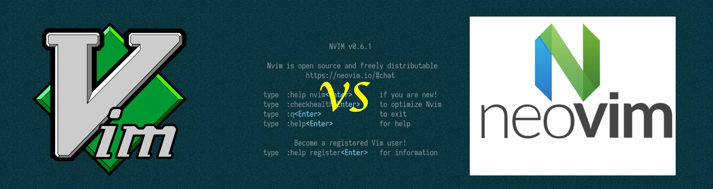
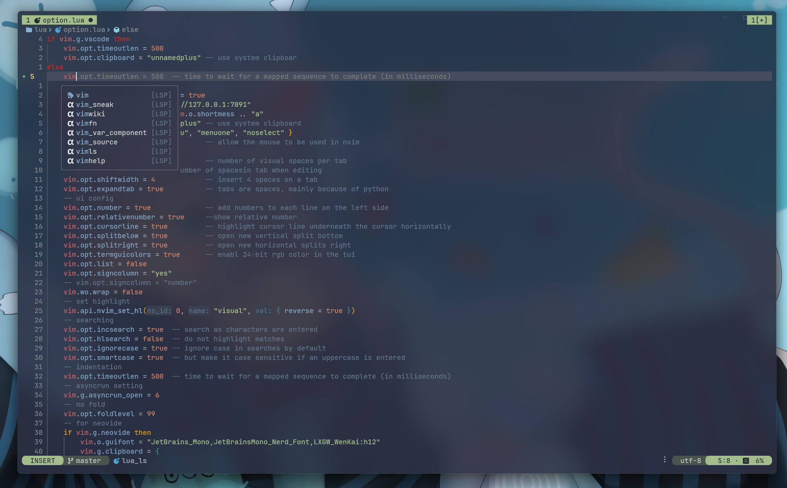

# Neovim 的前世今生



想要谈谈 Neovim，那就不得不谈谈它的发源---大名鼎鼎的 Vim 编辑器。

> Vim 于 1991 年由 Bram 发布，最初 Vim 模仿了 Vi 编辑器的特性，后面加以扩展，逐步添加了很多新功能。今年距离 Vim 首次发布已经快 30 年了，Vim 这个强大的编辑器仍然在不断更新，并且被许多人所使用和讨论，这也从侧面说明了 Vim 的魅力 (Vim 被网友们尊称为「编辑器之神」)。刚开始，Vim 完全由 Bram 独立开发维护，后来不断有开发者加入 Vim 的开发，并把 Vim 移植到了不同的系统平台上。有一段时间，Bram 甚至辞去了工作，全力投入到 Vim 的开发，靠着网友的捐助维持基本生活。

正因为是由 Bram 独立维护，Vim 虽然是开源软件，但是开发范式并非像现代的开源社区一样，随意进行PR就能对项目代码做修改，而是需要给Bram本人提交补丁，并决定是否把你的补丁加入核心之中。但是只有 Bram 才有权力决定什么代码可以合并入 Vim，什么样的代码不行 (Bram 就是 Vim 项目的 [BDFL](https://en.wikipedia.org/wiki/Benevolent_dictator_for_life))。Bram 对于添加新功能非常谨慎，导致之前有很多开发者提交的 patch 都没有被合并，引起了一些开发者对 Vim 开发模式的不满。这也引发了很多人对 Vim 项目未来能否可持续发展的担忧，当 Bram 去世以后，Vim 的未来会怎样？

> Neovim 项目的发起人 tarruda3 曾经给 Vim 提了一个 patch，为 Vim 增加了 job 功能，可以帮助 Vim 异步执行操作。不过遗憾的是，该 patch 不知为什么没有被 Bram 接受。因此 Tarruda 在 2014 年 fork 了 Vim，发起了 Neovim 项目，开始改变 Vim 的开发模式，遵循现代开源项目的开发流程，同时对 Vim 杂乱的代码进行了大的清理和重构，去掉了对老旧系统的支持，同时添加了新的特性。

这就是 Neovim 诞生的契机。从此 Neovim 就和 Vim 走上了两条截然不同的道路。Neovim 天然就更受开源社区欢迎，只因 Neovim 就是为开源而生的。Neovim 实现了很多新特性，例如内置 terminal 和异步功能都是 Neovim 率先实现，然后 Vim 才跟进实现的，可能是 Bram 也感受到了来自 Neovim 竞争的压力，不希望自己的项目失去开发者的青睐，加快了开发的步伐。遗憾的是，Vim 重新实现的异步功能，方法命名上选择了与 Neovim 不兼容，在 Neovim 中，发起和停止 job 的方法是 jobstart() 和 jobstop()，但是 Vim 使用的是 job_start() 和 job_stop()，这也给开发者和用户造成了不必要的麻烦。

如今的 Neovim，已经原生内建了 LSP 支持，即 [Language Server Protocol](https://microsoft.github.io/language-server-protocol/), 这个协议能够帮助任何一个文本编辑器，拥有贴近 IDE 的静态检查，格式化支持。同时还支持一种很快的语法解析库 [Tree-sitter](https://tree-sitter.github.io/), 能够提供轻量，快速的基于语义的代码高亮。

在这些的基础上，Neovim 拥有一个极其活跃和庞大社区，产出了数量丰富的优秀插件，其中很多都广受好评。不夸张的说，如今 Neovim 已经不亚于一个普通的IDE了。



# Neovim的简单配置

> 当你考虑要试试 Neovim 的时候，可以再来看看这个部分。

我的Neovim配置在[这里](https://github.com/Parsifa1/nvim), 配置的时候可以用作参考。

## 关于Lua

Neovim的原生语言支持是 lua，这门语言简单易学，你并不需要单独去学它，在学习配置的过程中，自然而然就会学会这门语言。

你可以简单参考这个[教程](https://learnxinyminutes.com/docs/lua/)，不过过于复杂的功能一开始是用不到的。

lua的最基本的数据结构就是表 (Table), 类似键值对，我们的配置文件大部分的工作实际上也只是向插件的各种配置里去传入 Table 而已。

## 配置的文件结构

Nvim 的配置目录在 ~/.config/nvim 下。在 Linux/Mac 系统上，Nvim 会默认读取 ~/.config/nvim/init.lua 文件，理论上来说可以将所有配置的东西都放在这个文件里面，但这样不是一个好的做法，因此我划分不同的文件和目录来分管不同的配置。

按照我的划分之后你的配置目录下的文件结构可能如下：

```
├── init.lua
├── lua
│   ├── custom.lua
│   ├── keymap.lua
│   ├── option.lua
│   ├── plugin.lua
│   ├── plugins
│   │   ├── core 核心插件
│   │   │   ├── Mason.lua
│   │   │   ├── nvim-cmp.lua
│   │   │   ├── nvim-lsp.lua
│   │   │   └── ......
│   │   ├── edit 优化编辑效率
│   │   │   ├── flash.lua
│   │   │   ├── ......
│   │   ├── git git相关
│   │   │   └── neogit.lua
│   │   │   ├── ......
│   │   ├── others 其他
│   │   │   └── ......
│   │   ├── theme 主题
│   │   │   ├── catppuccin.lua
│   │   │   ├── everforest.lua
│   │   │   ├── nightfox.lua
│   │   │   └── ......
│   │   ├── tools 工具，也是大部分插件的位置
│   │   │   ├── telescope.lua
│   │   │   ├── ......
│   │   └── ui 界面相关的插件
│   │       ├── lualine.lua
│   │       ├── mini-file.lua
│   │       └── toggleterm.lua
│   │       ├── ......
│   ├── snippets luasnip所需要的自定义代码片段
│   │   ├── cpp.lua
│   │   └── rust.lua
│   └── ......
```

## 写给曾经的 Vim用户

如果你曾经使用过 Vim ，很多东西会比较熟悉，但是本篇文章追求 100% lua配置，尽量不使用VimScript，所以你们可以参照表格对应一下等价代码：

| In Vim          | In Neovim               |
| --------------- | ----------------------- |
| let g:foo = bar | vim.g.foo = bar         |
| set foo = bar   | vim.opt.foo = bar       |
| some_vimscript  | vim.cmd(some_vimscript) |

在 Nvim 里面进行按键绑定的语法如下，具体的解释可以看 :h vim.keymap.set。

```lua
vim.keymap.set(<mode>, <key>, <action>, <opts>)
```

## 安装Neovim

我用的是 Arch，用 pacman 安装 Nvim 非常容易，只要运行如下命令即可

```shell
sudo pacman -S neovim
```

如果你用的是其他系统或设备，可以去neovim官网寻找下载方法。
在安装完成之后，如果 ~/.config/nvim 目录不存在，创建目录并新建 init.lua 文件

```shell
mkdir ~/.config/nvim
mkdir ~/.config/nvim/lua
touch ~/.config/nvim/init.lua
```

在 lua 文件夹下创建option.lua,主要存放大部分的设置。

选项配置功能一览：

- 默认采用系统剪贴板，同时支持鼠标操控 Nvim
- Tab 和空格的换算
- UI 界面
- “智能”搜索

```lua
-- Hint: use `:h <option>` to figure out the meaning if needed
vim.opt.clipboard = 'unnamedplus' -- use system clipboard
vim.opt.completeopt = { 'menu', 'menuone', 'noselect' }
vim.opt.mouse = 'a' -- allow the mouse to be used in Nvim

-- Tab
vim.opt.tabstop = 4 -- number of visual spaces per TAB
vim.opt.softtabstop = 4 -- number of spacesin tab when editing
vim.opt.shiftwidth = 4 -- insert 4 spaces on a tab
vim.opt.expandtab = true -- tabs are spaces, mainly because of python

-- UI config
vim.opt.number = true -- show absolute number
vim.opt.relativenumber = true -- add numbers to each line on the left side
vim.opt.cursorline = true -- highlight cursor line underneath the cursor horizontally
vim.opt.splitbelow = true -- open new vertical split bottom
vim.opt.splitright = true -- open new horizontal splits right
-- vim.opt.termguicolors = true        -- enabl 24-bit RGB color in the TUI
vim.opt.showmode = false -- we are experienced, wo don't need the "-- INSERT --" mode hint

-- Searching
vim.opt.incsearch = true -- search as characters are entered
vim.opt.hlsearch = false -- do not highlight matches
vim.opt.ignorecase = true -- ignore case in searches by default
vim.opt.smartcase = true -- but make it case sensitive if an uppercase is entered
```

然后打开 init.lua，用 require 导入刚才写的 option.lua 文件

```lua
require 'option'
```

## 简单按键配置

在 lua 文件夹下创建 keymap.lua,主要存放大部分的快捷键配置。

按键功能一览：

- 用 <z + h/j/k/l> 快速在多窗口之间移动光标
- 用方向键进行窗口大小的调整
- ……

```lua
-- 自定义set函数，方便使用
set = function(mode, keys, func, ...)
    local options = { noremap = true, silent = true }
    local arg = { ... }
    if #arg > 0 then
        local desc = arg[1]
        options.desc = desc
    end
    vim.keymap.set(mode, keys, func, options)
end

-- 窗口操作
set("n", "<up>", ":res +5<CR>")
set("n", "<down>", ":res -5<CR>")
set("n", "<left>", ":vertical resize-5<CR>")
set("n", "<right>", ":vertical resize+5<CR>")

-- 搜索保持光标
set("n", "n", "nzzzv")
set("n", "N", "Nzzzv")

-- 行移动
set("v", "J", ":m '>+1<CR>gv=gv")
set("v", "K", ":m '<-2<CR>gv=gv")

-- 窗口关闭
set("n", "<A-q>", ":q<CR>")
set("t", "<A-q>", "<C-\\><C-n>:q<CR>")
set("i", "<A-q>", "<Esc>:q<CR>")

-- insert模式下的方向键
set("i", "<A-l>", "<Right>")
set("i", "<A-h>", "<Left>")

-- 分屏
set("n", "z", "<C-w>")
set("n", "zp", ":sp<CR>", "split")

-- 折叠
set("n", "za", "za")

-- 其他
set({ "n", "v" }, "H", "^")
set({ "n", "v" }, "L", "$")
```

## 选择插件管理器

首选 [Lazy.nvim](https://github.com/folke/lazy.nvim)。

这是由一位传奇的 neovim 插件开发者 [folke](https://github.com/folke) 开发的，他开发了无数精致且有用的插件，比如 [which-key](https://github.com/folke/which-key.nvim), [noice](https://github.com/folke/noice.nvim), 等等，你只需要知道，他的插件大部分都是精品，你可以有选择性的使用。

在 lua 文件夹下创建 plugin.lua, 并创建 plugins 文件夹。

新建 ~/.config/nvim/lua/plugin.lua 文件并放入如下内容。下面的模板只完成了 Lazy.vim 自身的安装，还没有*指定其他第三方插件*。这个模板的功能主要是

1. 初次启动的时候自动安装 `Lazy.nvim`
1. 自动加载位于 plugins 文件夹里的分文件夹的插件内容
1. 设置leader键为空格（在这里设置防止无法生效)

```lua
vim.g.mapleader = " "
local lazypath = vim.fn.stdpath("data") .. "/lazy/lazy.nvim"
if not vim.loop.fs_stat(lazypath) then
    vim.fn.system({
        "git",
        "clone",
        "--filter=blob:none",
        "https://github.com/folke/lazy.nvim.git",
        "--branch=stable", -- latest stable release
        lazypath,
    })
end
vim.opt.rtp:prepend(lazypath)

if vim.g.vscode then
    require("lazy").setup({
        spec = {
            { import = "plugins.edit" },
        },
    })
else
    require("lazy").setup({
        spec = {
            -- 每当你在plugins目录下创建了一个文件夹，你就可以在这里加进去，文章之后会默认你创建了这些plugins下的子文件夹
            { import = "plugins.core" },
            { import = "plugins.edit" },
            { import = "plugins.git" },
            { import = "plugins.others" },
            { import = "plugins.theme" },
            { import = "plugins.tools" },
            { import = "plugins.ui" },
        },
        ui = {
            border = "rounded",
        },
    })
end
```

然后在 `init.lua` 文件里面再次加上一行导入这个文件

```lua
require 'plugin'
```

添加之后重启即可，`Lazy`会自动安装自己。

## 主题配置

我喜欢的主题是 nightfox 中的 Nordfox, 在 `plugins/theme/` 中创建 `nightfox.lua` ，

在里面加上

```lua
return {
    "EdenEast/nightfox.nvim",
    config = function()
        require("nightfox").setup()
    end
}
```

在 lua 文件夹下创建 custom.lua , 存放一些自定义函数，美化设定，以及常用的nerd font 图标。

```lua
-- in custom.lua
local M = {}

-- Border style of floating windows
M.border = "rounded"

M.theme = "nordfox"
```

然后在 `option.lua` 中加入

```lua
vim.cmd("colorscheme " .. require("custom").theme)
```

重启 nvim ，你会发现，主题已经生效了🥰

## Tree-sitter 设置

Tree-sitter 是一个非常快的语法解析库，能够提供轻量，快速的基于语义的代码高亮。配置Tree-sitter:

- 在 `core` 文件夹中创建 `tree-sitter.lua` 文件，加入如下内容：

```lua title="tree-sitter.lua" {2}
return {
    "nvim-treesitter/nvim-treesitter",
    event = "BufReadPre",
    build = ":TSUpdate",
    config = function()
        require("nvim-treesitter.configs").setup {
            ensure_installed = {
                "lua",
                "markdown",
                "vim",
                -- 加入你需要的语言
            },
            sync_install = true,
            auto_install = true,
            highlight = {
                enable = true,
                additional_vim_regex_highlighting = false,
            },
        }
    end,
}
```

重启 nvim ，等待 treesitter 的 parser 安装完成，很快代码高亮将会自动应用.

## LSP 设置

## CMP 设置

> 未完待续...

# 参考文章

[从零开始配置 Neovim](https://martinlwx.github.io/zh-cn/config-neovim-from-scratch)

[neovim 和 vim 的前世今生](https://jdhao.github.io/2020/01/12/vim_nvim_history_development/)
